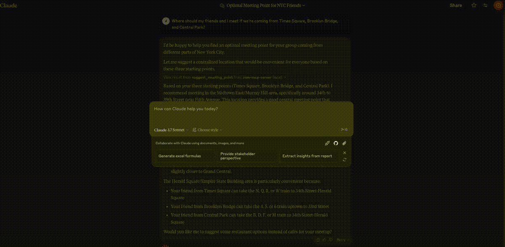

# OpenStreetMap (OSM) MCP Server

An OpenStreetMap MCP server implementation that enhances LLM capabilities with location-based services and geospatial data.

## Demo

### Parking Search



## Installation

### In MCP Hosts like Claude Desktop, Cursor, Windsurf, etc.
- `osm-mcp-server`: The main server, available for public use.
  
  ```json
  "mcpServers": {
    "osm-mcp-server": {
      "command": "uvx",
      "args": [
        "osm-mcp-server"
      ]
    }
  }
  ```

## Features

This server provides LLMs with tools to interact with OpenStreetMap data, enabling location-based applications to:

- Geocode addresses and place names to coordinates
- Reverse geocode coordinates to addresses
- Get route directions between locations
- Find schools and educational institutions near a location
- Analyze commute options between home and work
- Locate EV charging stations with connector and power filtering
- Find parking facilities with availability and fee information

## Components

### Resources

The server implements location-based resources:
- `location://place/{query}`: Get information about places by name or address
- `location://map/{style}/{z}/{x}/{y}`: Get styled map tiles at specified coordinates

### Tools

The server implements several geospatial tools:
- `geocode_address`: Convert text to geographic coordinates
- `reverse_geocode`: Convert coordinates to human-readable addresses
- `get_route_directions`: Get turn-by-turn directions between locations
- `find_schools_nearby`: Locate educational institutions near a specific location
- `analyze_commute`: Compare transportation options between home and work
- `find_ev_charging_stations`: Locate EV charging infrastructure with filtering
- `find_parking_facilities`: Locate parking options near a destination


## Local Testing

### Running the Server

To run the server locally:

1. Install the package in development mode:

```bash
pip install -e .
```

2. Start the server:

```bash
osm-mcp-server
```

3. The server will start and listen for MCP requests on the standard input/output.

### Testing with Example Clients

The repository includes two example clients in the `examples/` directory:

#### Basic Client Example

`client.py` demonstrates basic usage of the OSM MCP server:

```bash
python examples/client.py
```

This will:
- Connect to the locally running server
- Get information about San Francisco

#### LLM Integration Example

`llm_client.py` provides a helper class designed for LLM integration:

```bash
python examples/llm_client.py
```

This example shows how an LLM can use the Location Assistant to:
- Get location information from text queries
- Get directions between locations

### Writing Your Own Client

To create your own client:

1. Import the MCP client:
```python
from mcp.client import Client
```

2. Initialize the client with your server URL:
```python
client = Client("http://localhost:8000")
```

3. Invoke tools or access resources:
```python
# Example: Geocode an address
results = await client.invoke_tool("geocode_address", {"address": "New York City"})
```

#### Claude Desktop config for local server

On MacOS: `~/Library/Application\ Support/Claude/claude_desktop_config.json`
On Windows: `%APPDATA%/Claude/claude_desktop_config.json`

<details>
  <summary>Development/Unpublished Servers Configuration</summary>
  
  ```json
  "mcpServers": {
    "osm-mcp-server": {
      "command": "uv",
      "args": [
        "--directory",
        "/path/to/osm-mcp-server",
        "run",
        "osm-mcp-server"
      ]
    }
  }
  ```
</details>


## Development

### Building and Publishing

To prepare the package for distribution:

1. Sync dependencies and update lockfile:
```bash
uv sync
```

2. Build package distributions:
```bash
uv build
```

This will create source and wheel distributions in the `dist/` directory.

3. Publish to PyPI:
```bash
uv publish
```

Note: You'll need to set PyPI credentials via environment variables or command flags.

### Debugging

Since MCP servers run over stdio, debugging can be challenging. For the best debugging
experience, we strongly recommend using the [MCP Inspector](https://github.com/modelcontextprotocol/inspector).

You can launch the MCP Inspector via [`npm`](https://docs.npmjs.com/downloading-and-installing-node-js-and-npm) with this command:

```bash
npx @modelcontextprotocol/inspector uv --directory /path/to/osm-mcp-server run osm-mcp-server
```

Upon launching, the Inspector will display a URL that you can access in your browser to begin debugging.


